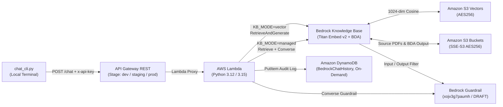

# Project Context & Architectural Decisions

## Goal
Serverless RAG chatbot over AI white paper PDFs in AWS `eu-west-1` with $0 idle compute cost and a clean teardown script.

## Locked-In Design Choices
- **Region:** `eu-west-1` (Ireland)
- **Encryption:** AWS Owned / AWS Managed Keys (`AES256`) only — no Customer Managed KMS keys ($0 key fees).
- **Vector Store & Source Storage:** Amazon S3 Vectors (1024 dimensions, cosine metric, float32) + standard S3 source & supplemental buckets.
- **Document Parsing:** Bedrock Data Automation (`BEDROCK_DATA_AUTOMATION`) enabled on the Knowledge Base data source.
- **Guardrail:** Existing Bedrock Guardrail ID `xojv3g7paumh` (version `DRAFT`), enforced via `retrieve_and_generate`.
- **Orchestration & State:** Direct `bedrock-agent-runtime.retrieve_and_generate` (for `KB_MODE=vector`) or `retrieve` + `converse` (for `KB_MODE=managed`) inside Python 3.12 AWS Lambda (`bedrock-rag-chat-*`), logging session turns and source URIs to an On-Demand DynamoDB table (`BedrockChatHistory-*`). Supports `MEMORY_MODE=single` (default, stateless) or `MEMORY_MODE=multi` (loads recent session turns from DynamoDB for follow-up questions).
- **API & Auth:** Public regional API Gateway REST API (`POST /chat`) secured with an API key (`x-api-key`) and usage plan throttling (no VPC, ALB, or WAF).
- **Client:** Local CLI script (`chat_cli.py`) using Python stdlib (`urllib.request`).

## Architecture Diagram

## Repo Files
- `deploy.sh` — Imperative AWS CLI deployment script (writes state to gitignored `.env.lab`).
- `teardown.sh` — Deletes all deployed resources in reverse dependency order while preserving Guardrail `xojv3g7paumh`.
- `lambda/handler.py` — Lambda handler calling `retrieve_and_generate` and writing audit logs to DynamoDB.
- `chat_cli.py` — Interactive CLI chat client.
