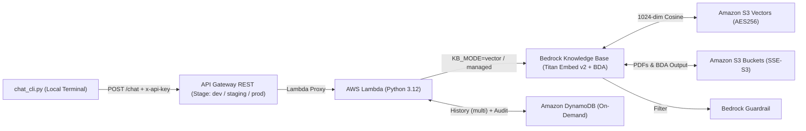

# AWS Bedrock RAG Chatbot Experiment

Serverless Retrieval-Augmented Generation (RAG) chatbot built on Amazon Bedrock in `eu-west-1` with zero idle compute costs:
- **Amazon Bedrock Knowledge Base** with **Amazon S3 Vectors** (1024-dim cosine index)
- **Bedrock Data Automation (BDA)** for multimodal PDF parsing
- **Amazon Bedrock Guardrails** (`${FULL_PREFIX}-guardrail-*`, or reuse an existing `GUARDRAIL_ID`) for content, profanity/word, and PII filtering
- **AWS Lambda + API Gateway (REST + API Key)** for serverless inference
- **Amazon DynamoDB (On-Demand)** for session chat history and audit logging

## Architecture



## Usage

1. Place 1–2 short PDF white papers into `app_docs/`.
2. *(Optional)* Copy `config.env.example` to `config.env` to skip interactive prompts:
   ```bash
   cp config.env.example config.env
   ```
3. *(Optional)* Run the local unit, contract, and mutation test suites (no AWS credentials required):
   ```bash
   python3 -m unittest discover -s tests -v
   python3 tests/mutation_test.py
   ```
4. Deploy the stack (discovers reusable resources from prior runs, displays a pre-deploy build plan for confirmation, deploys, and runs a post-deploy smoke test):
   ```bash
   ./deploy.sh
   # or pass flags / positional overrides:
   ./deploy.sh --yes dev multi my-bot rvh
   ./deploy.sh --skip-smoke-test
   ```
5. Export the `RAG_API_URL` and `RAG_API_KEY` printed at the end of `deploy.sh`, then start chatting:
   ```bash
   python3 chat_cli.py
   ```
6. Tear down lab resources when finished (prompts to type `YES` in capital letters to keep the Knowledge Base & vector storage and save `KB_NAME`/`KB_ID` to `config.env` for reuse on the next `./deploy.sh`):
   ```bash
   ./teardown.sh
   # or non-interactively: ./teardown.sh --keep-kb  |  ./teardown.sh --delete-kb
   ```

## Stages

- **Run in a different stage:** Pass the stage name to `./deploy.sh` (e.g. `./deploy.sh dev` or `./deploy.sh staging`) or enter it when prompted. Note that `./deploy.sh` creates a new timestamped stack each time and overwrites `.env.lab`, so run `./teardown.sh` before deploying another stack—or back up `.env.lab` per stage (e.g. `.env.lab.dev`).
- **Find available stages:**
  - **AWS Console (`eu-west-1`):** Open **API Gateway** → select your API (`${FULL_PREFIX}-api-*`, e.g. `lab-bedrock-rag-api-*`) → click **Stages** in the left sidebar.
  - **AWS CLI:**
    ```bash
    source .env.lab
    aws apigateway get-stages --rest-api-id "${API_ID}" --region "${AWS_REGION}" --query 'item[].stageName' --output table
    ```
  - **Check your current `.env.lab` stage:**
    ```bash
    grep STAGE .env.lab
    ```

## Documentation

- [docs/ARCHITECTURE.md](docs/ARCHITECTURE.md) — Architectural decisions and system diagram
- [docs/RUNNING_SCRIPTS.md](docs/RUNNING_SCRIPTS.md) — Podman, CloudShell, and local deployment instructions

## License

Licensed under the [MIT License](LICENSE).
