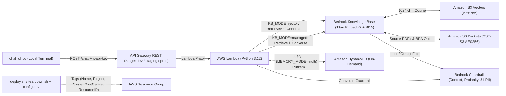

# Project Context & Architectural Decisions

## Goal
Serverless RAG chatbot over AI white paper PDFs in AWS `eu-west-1` with $0 idle compute cost and a clean teardown script.

## Locked-In Design Choices
- **Region:** `eu-west-1` (Ireland)
- **Encryption:** AWS Owned / AWS Managed Keys (`AES256`) only — no Customer Managed KMS keys ($0 key fees).
- **Vector Store & Source Storage:** Amazon S3 Vectors (1024 dimensions, cosine metric, float32) + standard S3 source & supplemental buckets.
- **Document Parsing:** Bedrock Data Automation (`BEDROCK_DATA_AUTOMATION`) enabled on the Knowledge Base data source.
- **Guardrail:** `deploy.sh` creates a Bedrock Guardrail (`${FULL_PREFIX}-guardrail-${SUFFIX}`, version `DRAFT`) with `HIGH` content filters, `PROFANITY` + custom word blocking, and 31 PII anonymizers — or reuses a pre-configured `GUARDRAIL_ID` / existing guardrail from a previous run — enforced via `retrieve_and_generate` / `converse`.
- **Orchestration & State:** Direct `bedrock-agent-runtime.retrieve_and_generate` (for `KB_MODE=vector`) or `retrieve` + `converse` (for `KB_MODE=managed`) inside Python 3.12 AWS Lambda (`${FULL_PREFIX}-chat-${SUFFIX}`), logging session turns and S3/SharePoint/Web citation URLs to an On-Demand DynamoDB table (`${FULL_PREFIX}-history-${SUFFIX}`). Supports `MEMORY_MODE=single` (default, stateless) or `MEMORY_MODE=multi` (loads recent session turns from DynamoDB for follow-up questions).
- **API & Auth:** Public regional API Gateway REST API (`POST /chat`) secured with an API key (`x-api-key`) and usage plan throttling (`rateLimit=5`, `burstLimit=10`, `limit=1000/DAY`) — no VPC, ALB, or WAF.
- **Resource Grouping:** All deployed and reused resources are tagged (`Name=${FULL_PREFIX}`, `Project=${APP_NAME}`, `Stage=${STAGE}`, `Stack=${SUFFIX}`, `CostCentre=${TAG_COST_CENTRE}`, `ResourceID=${TAG_RESOURCE_ID}`) and grouped under an AWS Resource Group (`${FULL_PREFIX}-${STAGE}-${SUFFIX}`) for single-pane inspection and cleanup verification.
- **Client:** Local CLI script (`chat_cli.py`) using Python stdlib (`urllib.request`).

## Architecture Diagram

## Repo Files
- `config.env.example` — Template for non-interactive `config.env` deployments (copy to `config.env`, gitignored).
- `deploy.sh` — Modular deployment entrypoint (writes state to gitignored `.env.lab`).
- `teardown.sh` — Modular teardown entrypoint deleting all deployed resources in reverse dependency order.
- `scripts/` — Composable infrastructure modules (`lib/common.sh`, `guardrail.sh`, `storage.sh`, `knowledge_base.sh`, `compute_api.sh`, `resource_group.sh`, `checks.sh`).
- `lambda/handler.py` — Lambda handler calling `retrieve_and_generate` (`KB_MODE=vector`) or `retrieve` + `converse` (`KB_MODE=managed`), extracting S3/SharePoint/Web citation URLs, and writing audit logs to DynamoDB.
- `tests/` — Local unit & API contract tests (`python3 -m unittest discover -s tests -v`).
- `chat_cli.py` — Interactive CLI chat client.

## Resource Naming & Tagging

With `FULL_PREFIX="${PREFIX}-${APP_NAME}"` (e.g. `lab-bedrock-rag`) and a Unix timestamp `SUFFIX`, `deploy.sh` names every resource consistently:

| Service / Resource | Naming Pattern |
| :--- | :--- |
| **AWS Resource Group** | `${FULL_PREFIX}-${STAGE}-${SUFFIX}` |
| **Bedrock Guardrail** | `${FULL_PREFIX}-guardrail-${SUFFIX}` |
| **S3 Source Bucket** | `${FULL_PREFIX}-docs-${ACCOUNT_ID}-${SUFFIX}` |
| **S3 Supplemental Bucket** | `${FULL_PREFIX}-bda-supp-${ACCOUNT_ID}-${SUFFIX}` |
| **S3 Vectors Bucket** | `${FULL_PREFIX}-vec-${SUFFIX}` |
| **S3 Vectors Index** | `whitepapers-index` |
| **Bedrock Knowledge Base** | `${FULL_PREFIX}-kb-${SUFFIX}` |
| **KB IAM Role** | `${FULL_PREFIX}-kb-role-${SUFFIX}` |
| **DynamoDB Table** | `${FULL_PREFIX}-history-${SUFFIX}` |
| **Lambda Function** | `${FULL_PREFIX}-chat-${SUFFIX}` |
| **Lambda IAM Role** | `${FULL_PREFIX}-lambda-role-${SUFFIX}` |
| **API Gateway REST API** | `${FULL_PREFIX}-api-${SUFFIX}` |
| **API Gateway Key** | `${FULL_PREFIX}-api-${SUFFIX}-key` |
| **API Gateway Usage Plan** | `${FULL_PREFIX}-api-${SUFFIX}-plan` |

All tagged resources receive: `Name=${FULL_PREFIX}`, `Project=${APP_NAME}`, `Stage=${STAGE}`, `Stack=${SUFFIX}`, `CostCentre=${TAG_COST_CENTRE}`, and `ResourceID=${TAG_RESOURCE_ID}`.

## Resource Reuse, Pre-Deploy Checks & Post-Deploy Smoke Test

Re-ingesting and vectorising documents via Bedrock Data Automation (BDA) and Titan Embed v2 takes time and incurs token costs. To avoid repeating ingestion and to prevent orphaned resources across lab cycles:
- **On `./teardown.sh`:** The script prompts whether to keep the Bedrock Knowledge Base (along with its S3 source/supplemental buckets, S3 Vectors index/bucket, and KB IAM role). Typing `YES` (exact uppercase) preserves those resources and writes `KB_NAME` and `KB_ID` into `config.env` (creating it from `config.env.example` if needed). Any other input tears them down and clears `KB_NAME`/`KB_ID` from `config.env`. (Non-interactive flags: `--keep-kb` / `--delete-kb`.)
- **On `./deploy.sh`:**
  - **Pre-deploy discovery & confirmation (`scripts/checks.sh`):** Checks `config.env` (`KB_ID` / `KB_NAME` / `GUARDRAIL_ID`) and scans AWS for reusable resources from previous runs (`${FULL_PREFIX}-kb-*`, `${FULL_PREFIX}-guardrail-*`, `${FULL_PREFIX}-history-*`) plus any leftover Lambdas, API Gateways, or Resource Groups. Displays a `[CREATE]` / `[REUSE]` / `[SKIP]` build plan and asks for confirmation (`--yes` to auto-approve).
  - **Resource Group re-tagging (`scripts/resource_group.sh`):** Re-tags any reused Knowledge Base, S3 buckets, IAM role, Guardrail, or DynamoDB table with the new `Stack=${SUFFIX}` so they appear inside the new AWS Resource Group.
  - **Post-deploy smoke test (`scripts/checks.sh`):** Runs 4 live `POST /chat` checks after deployment (RAG sample query + custom word block, prompt attack block, and PII anonymization) and prints HTTP status, `guardrail_action`, answers, and citation sources (`--skip-smoke-test` or `RUN_SMOKE_TEST="false"` to disable).

## Future Optimisations & Deferred Decisions

- **Direct SharePoint → Bedrock Managed Knowledge Base:** Treat this as a **future optimisation**, not a current HLD commitment. Before deciding whether it is worth replacing or simplifying the current S3 + S3 Vectors ingestion approach, assess:
  - **Setup effort** and ongoing operational overhead
  - **Entra ID authentication / App Registration** requirements (App-Only OAuth 2.0 with certificate; legacy Azure ACS retired April 2026)
  - **Permission scope** (`SHAREPOINT_PERMISSION_SCOPE` in `config.env`):
    | Scope | Access Level | Trade-offs |
    | :--- | :--- | :--- |
    | `Sites.Selected` *(Recommended)* | Only explicitly granted SharePoint sites | Least privilege; requires a SharePoint Admin to grant per-site access to the Entra ID App Registration via PowerShell/Graph API. |
    | `Sites.Read.All` | Read access to **all** SharePoint sites in the tenant | Faster initial setup (single Entra ID admin consent), but broad security blast radius. |
  - **Document-level ACL requirements** (whether user-level access control enforcement is required at retrieval time — note that Bedrock provides ACL-aware filtering, not an auth boundary, so enforcing per-user ACLs also requires authenticating callers at API Gateway rather than using a shared `x-api-key`)
