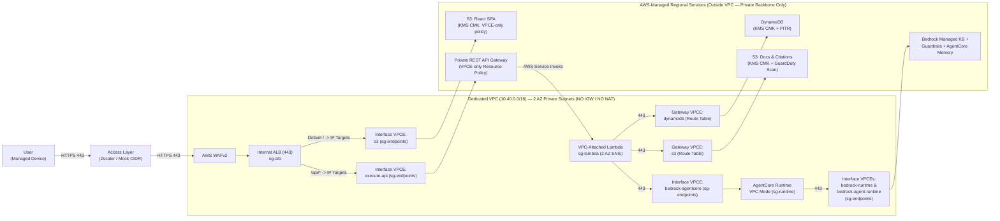
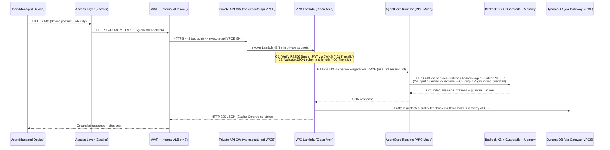

# Network Configuration & 2-Stack Terraform Runbook

This guide is written for **Network & Cloud Security teams** and engineers deploying the TDA-aligned architecture in `eu-west-1` using Terraform (`infra/terraform/stacks/{persistent,app}`). For the formal firewall matrix, IPAM plan, and sign-off checklist, see [NETWORK_LLD.md](NETWORK_LLD.md).

---

## 1. Visual Diagram: What Lives Inside vs. Outside the VPC

A common point of confusion is where AWS-managed AI and storage services sit. **Bedrock, Knowledge Bases, Guardrails, S3, DynamoDB, and even Private API Gateway always sit outside your VPC** — your VPC reaches them privately over **AWS PrivateLink (Interface VPCEs)** and **Gateway VPCEs**, with **zero Internet Gateway and zero NAT Gateway**.



---

## 2. End-to-End Request Flow (Sequence Diagram)



---

## 3. Network Engineer Configuration Matrix

### A. VPC, Subnets & Route Tables
| Component | Configuration | Notes |
| :--- | :--- | :--- |
| **VPC CIDR** | `10.40.0.0/16` *(configurable via `vpc_cidr`)* | `enable_dns_support = true`, `enable_dns_hostnames = true` |
| **Private Subnets (2 AZs)** | `10.40.1.0/24` (`eu-west-1a`), `10.40.2.0/24` (`eu-west-1b`) | `map_public_ip_on_launch = false` |
| **Internet / NAT Gateways** | **None** | Zero route to `0.0.0.0/0` — no internet egress possible |
| **Private Route Table** | Local VPC route + `dynamodb` & `s3` Gateway VPCE prefix-list routes only | Managed automatically by `modules/vpc_endpoints` |
| **VPC Flow Logs** | `traffic_type = "ALL"` → KMS-encrypted CloudWatch Log Group (90d retention) | Proves all traffic stays on private `443` paths |

### B. Security Group Matrix (All TCP `443` Only)
| Security Group | Inbound | Outbound |
| :--- | :--- | :--- |
| **`sg-alb`** | TCP `443` from `var.access_allowed_cidrs` (Zscaler connector CIDRs) | TCP `443` to `sg-endpoints` |
| **`sg-endpoints`** | TCP `443` from `sg-alb`, `sg-lambda`, `sg-runtime` | None |
| **`sg-lambda`** | None | TCP `443` to `sg-endpoints` + DynamoDB & S3 Gateway VPCE prefix lists |
| **`sg-runtime`** | None | TCP `443` to `sg-endpoints` |

### C. All 7 VPC Endpoints (`eu-west-1`)
| Service Name | Type | Private DNS | Policy / Health Check Notes |
| :--- | :--- | :---: | :--- |
| `com.amazonaws.eu-west-1.dynamodb` | Gateway | N/A | Route-table level, `aws:PrincipalAccount` policy |
| `com.amazonaws.eu-west-1.s3` | Gateway | N/A | Route-table level for Lambda S3 access, `aws:PrincipalAccount` |
| `com.amazonaws.eu-west-1.s3` | Interface | `false` | ALB default target group (`/`) uses ENI private IPs; **ALB health check matcher: `200,307,403,405`** |
| `com.amazonaws.eu-west-1.execute-api` | Interface | `true` | ALB `/api/*` target group uses ENI private IPs; **ALB health check matcher: `200,403`**; Private API Resource Policy denies any `aws:SourceVpce != execute-api-vpce` |
| `com.amazonaws.eu-west-1.bedrock-agentcore` | Interface | `true` | AgentCore Data Plane (Runtime + Memory), `aws:PrincipalAccount` |
| `com.amazonaws.eu-west-1.bedrock-runtime` | Interface | `true` | `Converse` + `ApplyGuardrail`, `aws:PrincipalAccount` |
| `com.amazonaws.eu-west-1.bedrock-agent-runtime` | Interface | `true` | `Retrieve` / `RetrieveAndGenerate`, `aws:PrincipalAccount` |

### D. 4 Inputs Needed from Your Network / Security Team for Production
1. **Zscaler connector egress CIDRs** (`access_allowed_cidrs`) for `sg-alb`.
2. **Private DNS record** (`A`/Alias) pointing your app hostname to the Internal ALB DNS name.
3. **ACM TLS certificate ARN** (`acm_certificate_arn`) matching that hostname in `eu-west-1`.
4. **Entra ID app registration values** (`entra_issuer`, `entra_audience`, `entra_jwks_url`).

---

## 4. Running the 2-Stack Terraform Build (via Podman)

Build and enter the tools container (includes AWS CLI v2 + Terraform `1.10.5`, zero host installs):
```bash
podman build -t aws-rag-cli .
podman run --rm -it \
  -v "$PWD:/work:Z" \
  -v "$HOME/.aws:/root/.aws:Z" \
  -w /work \
  aws-rag-cli
aws login --remote
```

### Stack 1 — Persistent Network, KMS & Knowledge Base (`stacks/persistent/`)
Deploy once and keep across app teardowns (preserves your Knowledge Base & vector index):
```bash
cd /work/infra/terraform/stacks/persistent
terraform init
terraform plan -var='access_allowed_cidrs=["10.40.0.0/16"]'
terraform apply -var='access_allowed_cidrs=["10.40.0.0/16"]'
```

### Stack 2 — Ephemeral App Stack (`stacks/app/`)
Reads VPC, VPCE, KMS, and KB outputs automatically from `../persistent/terraform.tfstate`:
```bash
cd /work/infra/terraform/stacks/app
terraform init
terraform plan \
  -var="acm_certificate_arn=arn:aws:acm:eu-west-1:<acct>:certificate/<id>" \
  -var="agentcore_runtime_arn=arn:aws:bedrock-agentcore:eu-west-1:<acct>:runtime/<id>"
terraform apply
```

### Clean Teardown (Keep Knowledge Base)
```bash
cd /work/infra/terraform/stacks/app
terraform destroy
```

---

## 5. How to Spin Up a Quick Demo for the Network Team

You have **two fast ways** to walk the network team through what is happening:

### Demo Option A — 2-Minute `$0` Dry-Run (`terraform plan`)
Run `terraform plan` in `stacks/persistent` and `stacks/app` inside Podman and screen-share the plan output. Network engineers can inspect every exact CIDR, Security Group rule, VPC Endpoint service name, VPCE policy, and ALB listener rule before creating a single resource.

### Demo Option B — 10-Minute Live Sandbox Walkthrough (No Zscaler / No Entra ID Needed)
1. Deploy `stacks/persistent` with `access_allowed_cidrs = ["10.40.0.0/16"]` (Mock Zscaler) and `stacks/app` with a test ACM cert and Mock OIDC settings.
2. Open **AWS CloudShell in VPC mode** (attached to one of the new private subnets with `sg-alb` allowed) — zero bastion EC2 setup required!
3. Run these 4 live commands in front of the network team:
   ```bash
   # 1. Prove Bedrock & API Gateway resolve to PRIVATE 10.40.x.x IPs (Private DNS)
   nslookup bedrock-runtime.eu-west-1.amazonaws.com
   nslookup bedrock-agentcore.eu-west-1.amazonaws.com

   # 2. Prove there is NO public internet route from the private subnet
   curl -I --max-time 3 https://example.com   # Times out as expected

   # 3. Run the live E2E security & guardrail checks against the Internal ALB
   export TDA_API_BASE_URL="https://<alb-dns-name>/api"
   export TDA_BEARER_TOKEN="<signed-rs256-mock-jwt>"
   python3 tests/e2e_tda_smoke.py

   # 4. Show VPC Flow Logs in CloudWatch Logs (all TCP 443 to VPCE ENIs, zero 0.0.0.0/0 egress)
   ```
