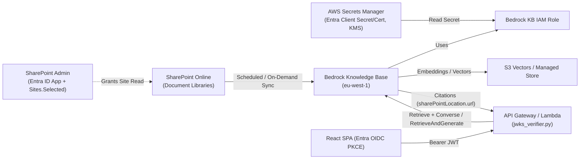

# Technical Design: SharePoint → Amazon Bedrock Knowledge Base

## Overview
Adds an optional Microsoft SharePoint Online data source to the existing Amazon Bedrock Knowledge Base (`infra/terraform/modules/knowledge_base` and `scripts/knowledge_base.sh`) using Entra ID App-Only OAuth 2.0 credentials stored in AWS Secrets Manager.

---

## Architecture Diagram

---

## Component Design

### 1. Entra ID & Secrets Manager
- **Terraform (`infra/terraform/modules/knowledge_base`):**
  - Add optional variables: `enable_sharepoint_source` (`bool`, default `false`), `sharepoint_site_urls` (`list(string)`), `sharepoint_tenant_id` (`string`), `sharepoint_secret_arn` (`string`), `sharepoint_permission_scope` (`Sites.Selected` | `Sites.Read.All`).
  - Grant `secretsmanager:GetSecretValue` on `sharepoint_secret_arn` to the Knowledge Base IAM role only when `enable_sharepoint_source = true`.
- **Bash Lab (`config.env` / `scripts/knowledge_base.sh`):**
  - Optional `SHAREPOINT_SITE_URLS`, `SHAREPOINT_TENANT_ID`, `SHAREPOINT_SECRET_ARN`, and `SHAREPOINT_PERMISSION_SCOPE` in `config.env`.

### 2. Citation Extraction
- Both `lambda/handler.py` and `backend/adapters/ai/agentcore_gateway.py` should extract:
  1. `location.s3Location.uri`
  2. `location.sharePointLocation.url`
  3. `location.webLocation.url`

### 3. Error Boundaries & Security Controls
- **Control C1 (Auth):** SharePoint-backed deployments must use `AUTH_MODE=oidc_pkce` (never unauthenticated or shared API key in production).
- **Control C6 (Logging):** `redacting_logger.py` must never log `sharepoint_secret_arn` payloads or Bearer tokens.
- **KMS:** Secrets Manager secret and Bedrock KB storage use the KMS key from `infra/terraform/modules/kms`.
